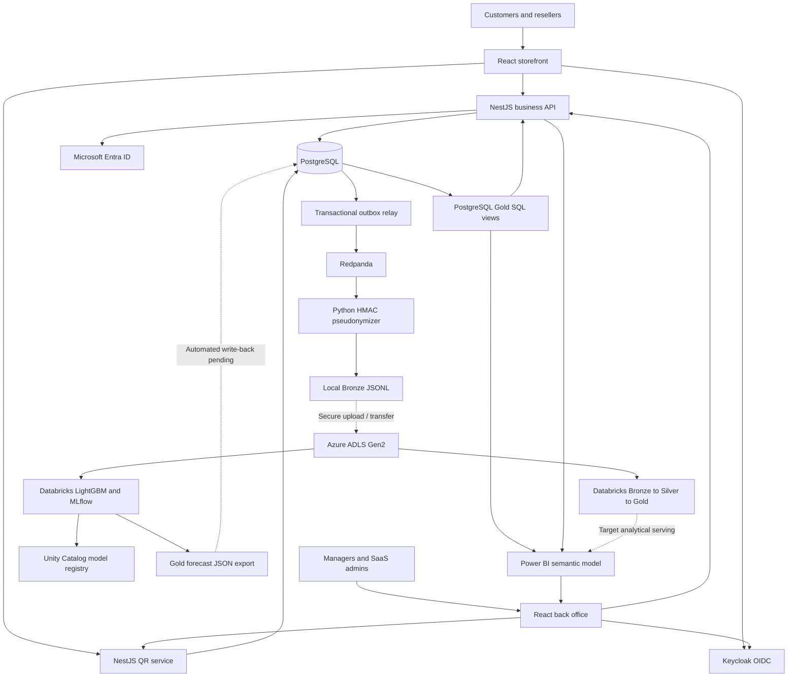
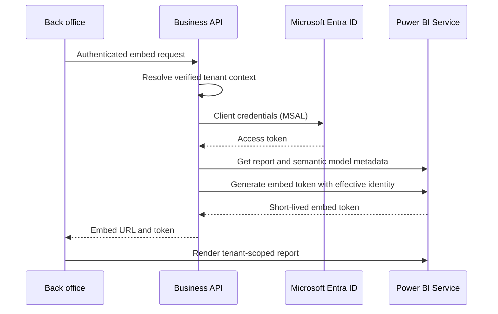
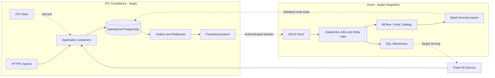

# AgriCoop Intelligence

**A multi-tenant agricultural SaaS prototype integrating commerce, traceability, event-driven data engineering, machine learning and embedded business intelligence.**

AgriCoop Intelligence is designed for Moroccan agricultural cooperatives, with the olive oil value chain as its proof of concept. It connects operational transactions with analytical and predictive capabilities in a single cooperative management experience. The application is container-ready; its target deployment separates the operational plane on Oracle Cloud Infrastructure (OCI) in Casablanca from the analytical plane on Microsoft Azure.

> **Project status:** working local application and Power BI Embedded integration; Azure Databricks notebooks implemented. Automated inter-cloud transfer, infrastructure provisioning and production deployment are pending. This repository is a proof of concept, not a certified production service.

## Business capabilities

| Actor | Capabilities |
| --- | --- |
| Customer / reseller | Browse cooperative catalogues, manage a cart, place orders, use a simulated payment flow and verify product authenticity |
| Cooperative manager | Manage products, lots, stock, orders and QR labels; monitor sales, customer segments, risks and forecasts |
| SaaS administrator | Manage platform-level operations and select a cooperative context for authorized administration |
| Data team | Generate reproducible synthetic data, process events, train models and expose decision-ready datasets |

The system models stock through movements rather than a mutable stock total. Order allocation follows first-expired, first-out (FEFO) and uses transactional locking. QR codes support lot- and unit-level traceability; suspicious scans generate alerts, not definitive judgments of counterfeit activity.

## System architecture

The monorepo separates the application plane, data plane and shared contracts. Solid links in the diagram represent implemented code paths; dashed links identify integrations that still require deployment or end-to-end validation.



The diagram represents logical relationships, not a claim that every service is already deployed remotely. The Power BI report currently uses the PostgreSQL analytical layer; direct Databricks serving is a target integration.

## Application plane

| Service | Responsibility | Local endpoint |
| --- | --- | --- |
| `apps/web` | Mobile-first storefront and public QR verification | `localhost:5173` |
| `apps/backoffice` | Cooperative management and SaaS administration | `localhost:5174` |
| `apps/api` | Catalogue, orders, stock, payments, analytics, forecasts and BI tokens | `localhost:3000` |
| `apps/qr` | Secure QR generation, PDF labels, verification and anomaly checks | `localhost:3001` |
| `apps/outbox-relay` | Publish transactional outbox events to Redpanda | `localhost:3002` |

React applications use typed API clients generated from OpenAPI, French and Arabic localization, and OIDC authorization code flow with PKCE. The backend uses NestJS on Fastify, Drizzle ORM, PostgreSQL and shared validation schemas. Payments use a CMI-style **mock** adapter; real payment and notification providers are not claimed as integrated.

## End-to-end information flow

1. A customer places an order or scans a QR code. The API or QR service validates the request, resolves the tenant and writes operational records to PostgreSQL.
2. Business events are recorded in the transactional outbox. A relay publishes `commande_creee`, `stock_modifie` and `qr_scanne` to `agricoop.events`, keyed by `coop_id`. Delivery is at least once; consumers must deduplicate by `event_id`.
3. The Python pseudonymizer validates the shared JSON Schema, replaces customer identifiers with HMAC-SHA256 tokens and rejects prohibited personal-data fields. It emits `agricoop.events.pseudo` and date-partitioned local Bronze JSONL files.
4. The Azure notebooks consume staged event files and ML input Parquet files in Unity Catalog volumes. Automated delivery from the operational plane into these volumes is still to be completed.
5. Spark deduplicates and normalizes events into Silver Delta tables and produces Gold sales, stock, QR and KPI datasets.
6. Forecasting produces a registered MLflow model and batch predictions stored in Gold Delta and exported as JSON. The application already reads PostgreSQL forecast tables; the automated Azure-to-PostgreSQL write-back is pending.
7. The operational analytical path uses PostgreSQL Gold views and the embedded Power BI report to return decision-ready insights to the manager.

## Data engineering and lakehouse

| Notebook | Implementation |
| --- | --- |
| [`01_bronze_ingestion.ipynb`](data/databricks/01_bronze_ingestion.ipynb) | Read staged JSON events, deduplicate by event ID, parse timestamps and payloads, write Silver Delta and Gold datasets |
| [`02_ml_prevision_demande.ipynb`](data/databricks/02_ml_prevision_demande.ipynb) | Read weekly Parquet inputs, compare forecasting methods, track experiments, register a model and run batch scoring |

Silver includes normalized `events`. Gold includes `ventes`, `mouvements_stock`, `kpi_cooperative`, `scans_qr`, historical daily sales and `prevision_demande`. The notebooks contain explicit external Delta storage paths and Unity Catalog table names tied to the development workspace. They currently use batch operations and several overwrite writes; they are not a continuously running streaming lakehouse. Parameterized paths, incremental processing, scheduling and replay tests are next steps.

The local synthetic data factory (`data/synthetic-factory/01_generateur.ipynb`) uses a fixed seed, Pandera validation, business checks and an audit manifest. The `is_synthetic` flag separates generated records from application-originated records where supported.

## Machine learning

| Capability | Approach | Integration |
| --- | --- | --- |
| Demand forecasting | Weekly product-level LightGBM; baseline, naive and stockout-corrected variants; chronological and walk-forward evaluation | Local PostgreSQL write-back and Azure notebook with MLflow / Unity Catalog |
| Customer segmentation | RFM indicators, K-means for individuals and a business rule for resellers | Local Gold segmentation output |
| QR anomaly detection | Scan-derived features, business rules compared with Isolation Forest | Local Gold alerts and operational QR checks |

The forecasting pipeline explicitly distinguishes observed sales from latent demand: stockouts can censor observed demand. Synthetic latent demand is used for evaluation rather than as a model feature. The Azure notebook logs metrics, signatures and models with MLflow, wraps inference preprocessing as a PyFunc model, registers it in Unity Catalog with a `Candidate` alias, and exports batch predictions for downstream write-back. The ML inputs are staged separately; their automated generation from the cloud lakehouse is not established by this snapshot.

See [`data/ml/`](data/ml/) and [`data/databricks/`](data/databricks/) for reproducible implementations. No unverified accuracy or business-impact claim is made here.

## Embedded business intelligence

The back office embeds a four-page Power BI report: **Overview, Stock, Forecasts and Controls**. The report includes sales and stock indicators, forecasts, QR risk alerts and loss monitoring.



The implementation follows *app owns data*. The manager does not need to sign in to Power BI. The backend supplies the `Cooperative` RLS role and uses the verified cooperative ID as the effective username; the DAX role filter is `[coop_id] = USERNAME()`. The `Admin` role is reserved for authorized platform-wide use. Secrets and Entra access tokens stay server-side. The five required environment settings enable live mode; otherwise, the UI can run in demo mode.

The local analytical endpoints separately read PostgreSQL `gold` views through the restricted `analytics_reader` role. See [Power BI setup](docs/powerbi-embedding.md) and [application documentation](apps/README.md). Embedded token generation was demonstrated during local development; cross-tenant acceptance tests and production capacity remain necessary.

## Security and governance

- **Identity and access:** Keycloak OIDC, JWKS-based JWT validation, roles and verified tenant context.
- **Tenant isolation:** `coop_id` scoping in repository queries, tenant-aware database access and Power BI RLS. PostgreSQL RLS proposals and deployment status must be checked separately; application-level filtering is not evidence that database RLS is enabled everywhere.
- **Privacy:** separate customer PII, event schema validation, keyed pseudonymization before export and redacted application logs. Pseudonymization is not anonymization. The design addresses Moroccan data-protection requirements; it is not a claim of CNDP approval or legal compliance certification.
- **QR security:** random 128-bit tokens, SHA-256 hashes at rest, rate limiting and anomaly checks.
- **Runtime:** non-root container images, health probes, metrics and CSP headers; production secret safeguards.
- **Secrets:** use `.env` only for local development. Use managed secret stores and restricted service identities in cloud deployments. Never publish credentials, real customer data or live QR tokens.

## Technology stack

| Layer | Technologies |
| --- | --- |
| Frontend | React 19, TypeScript, Vite, TanStack Router / Query, Tailwind CSS, shadcn/ui, Recharts, i18next |
| Backend and contracts | Node.js 24, NestJS, Fastify, Drizzle ORM, Zod, OpenAPI, Orval, JSON Schema |
| Identity and transactional data | Keycloak, PostgreSQL 16 |
| Event streaming | Transactional outbox, KafkaJS, Redpanda, Python, confluent-kafka |
| Data engineering | PySpark, Delta Lake, ADLS Gen2, Azure Databricks, Unity Catalog, Pandera |
| Machine learning | pandas, NumPy, scikit-learn, LightGBM, MLflow |
| Business intelligence | PostgreSQL Gold views, Power BI Desktop / Service, Power BI Embedded, MSAL, DAX |
| Quality and delivery | pnpm, Turborepo, Docker Compose, GitHub Actions, Vitest, Supertest, Testcontainers, Playwright |
| Cloud target | OCI Casablanca, Azure, Terraform, OKE and managed secrets (planned deployment) |

## Repository structure

```text
apps/                    # Storefront, back office, APIs, relay, E2E and container images
packages/                # Shared DB access, validation, events, UI and testing utilities
contracts/               # SQL schema, migrations, event schemas, OpenAPI contracts
data/
  synthetic-factory/     # Reproducible synthetic data and validation
  pipelines/             # Outbox relay, pseudonymization, event simulation
  databricks/            # Azure lakehouse and forecasting notebooks
  ml/                    # Local ML notebooks
  bi/                    # PostgreSQL Gold views and PBIX report
infra/
  terraform/oci/         # Reserved for OCI infrastructure
  terraform/azure/       # Reserved for Azure infrastructure
  helm/                  # Reserved for Kubernetes deployment
docs/                    # Engineering conventions, BI setup, application changelog
.github/workflows/       # Automated application CI
```

## Local development

Prerequisites: Node.js 24, pnpm 12, Docker with Compose v2, and Power BI Desktop / Service for optional BI setup.

```bash
cp .env.example .env
pnpm install
docker compose -f docker-compose.yml -f docker-compose.apps.yml up -d --wait
pnpm db:gold
pnpm dev
```

On Windows PowerShell, use `Copy-Item .env.example .env` rather than `cp` if preferred. If the API does not load the root environment in host-development mode, run it separately from `apps/api`:

```powershell
node --env-file=../../.env ./node_modules/@nestjs/cli/bin/nest.js start --watch
```

Stop the existing API process first to avoid port conflicts. The remaining development services must still be running. For a fully containerized local stack:

```bash
docker compose -f docker-compose.yml -f docker-compose.apps.yml --profile apps up -d --build --wait
```

Do not run host and containerized app services on the same ports simultaneously. For the complete synthetic COOP01 dataset, use the separately generated database dump and the restore instructions in [apps/README.md](apps/README.md); restoration replaces local database contents. COOP02 demo seeding and mock payments are described there.

## Testing and CI

```bash
pnpm lint
pnpm typecheck
pnpm test
pnpm format:check
pnpm --filter @agricoop/e2e e2e:install
pnpm e2e
```

The GitHub Actions workflow checks formatting, lint, types, tests and generated contract drift, builds five multi-architecture images (`linux/amd64`, `linux/arm64`), and runs Playwright against a Compose stack. The workflow builds images but does not yet implement registry publication or cloud deployment. The repository contains tests; their latest execution status must be verified in CI.

## Target multi-cloud deployment



The initial cloud MVP will reuse the existing images and Compose definitions on OCI, with Azure Databricks and ADLS for analytical processing. The next production-oriented iteration will provision networks, managed secrets, registry and deployment automation through Terraform, then evaluate OKE, managed database options, backup/recovery, observability and high availability. The `infra/` folders in this snapshot are placeholders, not deployable modules.

Before public exposure, validate private database and broker networking, HTTPS, OIDC redirects, CORS/CSP, database backup/restore, secret rotation, the inter-cloud identity and transfer mechanism, Power BI refresh and capacity, and tenant isolation across all layers.

## Demo and roadmap

A public demo video and screenshots will be added after cloud deployment and verification. Suggested demo: browse the storefront, place a mock order, show the manager dashboard, verify a QR code, explain the event and lakehouse flow, show MLflow forecasts and the embedded BI controls, then demonstrate tenant isolation.

- [x] Application services and shared contracts implemented
- [x] Local data factory, ML and BI artifacts included
- [x] Azure Databricks ingestion and forecasting notebooks included
- [x] Power BI Embedded demonstrated in local development
- [ ] Clean and parameterize notebooks; complete a fresh-run validation
- [ ] Verify CI results, tenant isolation and report refresh
- [ ] Deploy existing application images to OCI
- [ ] Automate pseudonymized event delivery and forecast write-back
- [ ] Schedule Databricks jobs and configure analytical serving
- [ ] Publish a sanitized demo video and architecture screenshots

## Contributors

- **Omar Boulahjour** — application plane: storefront, back office, API and QR service.
- **Mohamed Douas** — data plane: synthetic data, pipelines, machine learning and business intelligence.
- **Shared responsibilities** — contracts, architecture, infrastructure and integration.

This academic proof of concept uses synthetic data and simulated external integrations. A license has not been added in the reviewed snapshot; select an appropriate license jointly before presenting the repository as open source.
